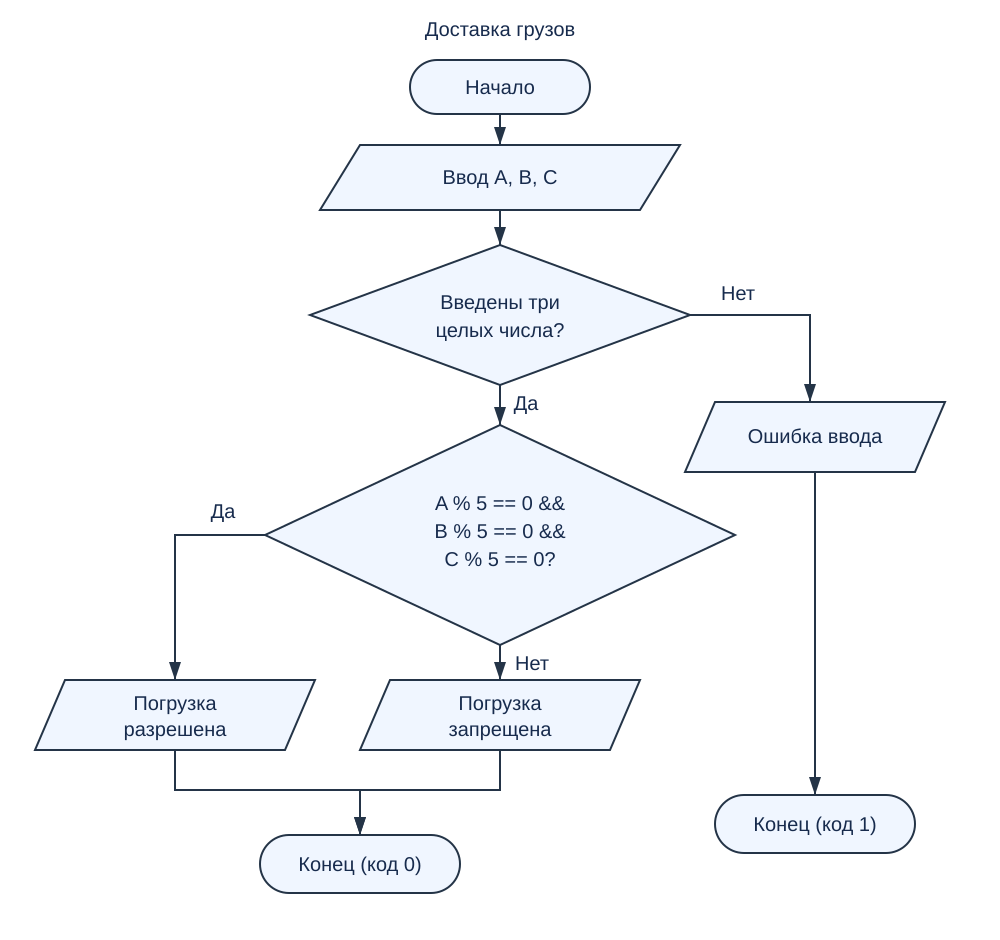

# Домашняя работа № 4. Доставка грузов

## Условие

Три груза (A, B, C кг) можно погрузить в контейнер, если вес каждого из них кратен пяти. Запишите условие, при котором диспетчерская система дает разрешение на погрузку.

## Решение

Веса вводятся как целые числа в килограммах. Разрешение выдается, если каждый из трех весов делится на 5 без остатка:

```c
A % 5 == 0 && B % 5 == 0 && C % 5 == 0
```

Оператор `%` вычисляет остаток от деления, `== 0` проверяет его равенство нулю, а `&&` означает логическое «И»: все три проверки должны быть истинными.

Дополнительная проверка положительности веса в условии задания не указана, поэтому программа проверяет только кратность пяти. Если вместо трех целых чисел введены некорректные данные, программа сообщает об ошибке.

## Файлы

- `main.c` — программа на языке C.
- `schema.svg` — блок-схема программы.
- `README.md` — описание решения и примеры.


## Примеры

| Ввод A B C | Результат |
| --- | --- |
| `10 15 20` | Погрузка разрешена |
| `10 12 20` | Погрузка запрещена |
| `5 25 30` | Погрузка разрешена |
| `11 16 21` | Погрузка запрещена |

## Блок-схема



## Вывод

Составлено условие разрешения погрузки с использованием операции остатка от деления и логического «И». Программа разрешает погрузку только тогда, когда все три веса кратны пяти.
